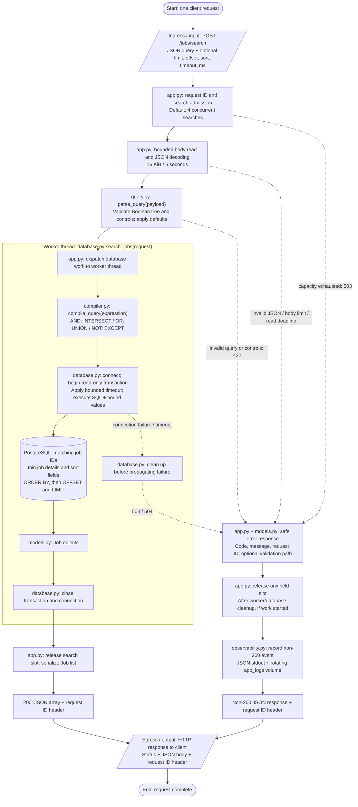

# Codebase request flow

This is the intended flow through the approved architecture. The current
application functions are skeleton stubs; these routes and calls are not yet
implemented. Solid arrows describe the successful search path; dashed arrows
describe rejection/error paths. Each traversal represents one request, from
ingress to egress and a terminal node; responses do not loop back to the input.

## How the modules fit together

| File | Responsibility on this path |
| --- | --- |
| `src/sumble_api/app.py` | HTTP boundary, admission, body limits, dispatch, status mapping, response handling |
| `src/sumble_api/query.py` | Validate raw JSON into `SearchRequest(Expression, SearchOptions)` |
| `src/sumble_api/compiler.py` | Build a SQL set of job IDs and separate parameters from the expression |
| `src/sumble_api/database.py` | Apply connection/transaction/timeout settings; add allowlisted sort and bound page controls; execute and clean up |
| `src/sumble_api/models.py` | Define the public `Job`, `ErrorDetail`, and `ErrorResponse` shapes |
| `src/sumble_api/observability.py` | Configure safe logs and correlate non-200 events with response request IDs |

`compiler.py` does not execute SQL. `database.py` owns the database connection and
the full search statement, including joins, sorting, and pagination. Sorting
must consider every matching job before offset/limit; selecting ten IDs first
would produce incorrect custom-sort pages.

The HTTP layer remains async; Psycopg work runs in a worker thread. A cancelled
HTTP task cannot return its search slot while that thread still runs SQL.
Cleanup finishes before capacity is released. Timeout defaults to 25,000 ms for
the database statement only, with a client range of 1–25,000 ms. It is not an
end-to-end HTTP deadline. Limit defaults/maxes to 10; offset defaults to zero;
sorting defaults to ID ascending, with nulls last and ID ascending for non-ID ties.

Unexpected server failures also pass through safe 500 handling and non-200
logging; the diagram highlights the common validation/database branches.
Middleware also covers non-search errors such as unknown routes and readiness
failures. No request bodies, query values, credentials, or raw driver errors go
into error logs. Aborted requests are recorded separately if no response is sent.

## Startup, health, and packaging paths

1. `docker-compose.yml` starts the supplied database and waits for its health check.
2. `Dockerfile` starts Uvicorn, which calls `app.py:create_app()` as a factory.
3. The factory configures logging and routes; `/health` checks process liveness
   without consuming a search slot. `/ready` calls `database.py:check_database()`
   with its own bounded readiness capacity and short database timeout.
4. `scripts/package.py:build_submission(output)` is an offline delivery path,
   not an HTTP route. It will package source, configuration, tests, and docs
   into a ZIP while excluding workflow/runtime artifacts.

The stub `create_app()` currently raises `NotImplementedError`; building the
image succeeds, but a running API awaits the implementation tickets.

## Verification map

`tests/test_query.py` covers validation; `test_compiler.py` covers SQL composition
and value binding; `test_database.py` covers actual SQL semantics, paging, sorting,
and timeout cleanup; `test_api.py` covers the HTTP contract; `test_concurrency.py`
covers admission/cancellation; `test_observability.py` covers safe persisted logs.
Only the import-safety smoke test exists at the skeleton stage.
