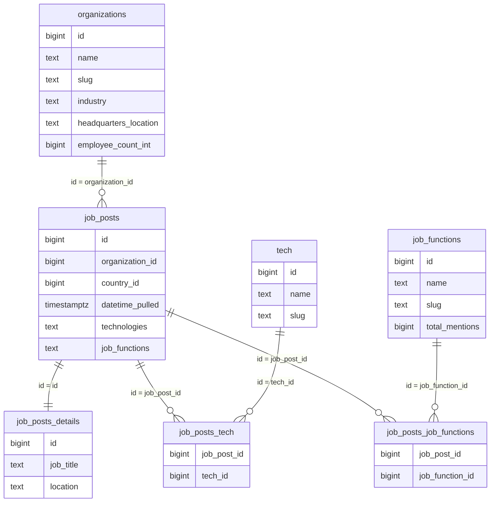

# Observed database

Inspected the supplied image while Compose was healthy:

`nzsne8pttnh8wrpu/p2ckp9ddret2arc2@sha256:714ff812e4d1ceb832ac41bc1a7d471cd5485fe14cb7a01b705909933a11097d`

Database: `sumble_data`. Schema: `public`. No indexes, primary keys, foreign
keys, unique constraints, or defaults were declared. Observed IDs are unique in
`job_posts`, `job_posts_details`, `organizations`, `tech`, and `job_functions`.
Relationship-table pairs are unique in this extract. This is inspection evidence
for the approved architecture, not a migration or index build.

Search matching uses dictionary `name` columns with case-insensitive exact
equality. Ignore denormalized `job_posts.technologies` and
`job_posts.job_functions`; those columns store `{'<id>': 1}` maps, not names.

## Schema



Every public column is nullable in the catalog. In this extract, entity IDs,
organization names, job titles, locations, and dictionary names are populated.

### job_posts — 89,397 rows

| Column | Type | Notes |
| --- | --- | --- |
| id | bigint | Unique job identifier; API `Job.id` |
| organization_id | bigint | Observed link to `organizations.id` |
| country_id | bigint | Opaque source country id; no local countries table |
| datetime_pulled | timestamptz | Sort field; range 2022-07-28 to 2023-03-06 UTC |
| technologies | text | Denormalized id map; do not parse |
| job_functions | text | Denormalized id map; do not parse |

### job_posts_details — 89,397 rows

| Column | Type | Notes |
| --- | --- | --- |
| id | bigint | Same value as `job_posts.id` |
| job_title | text | Sort field; no empty titles in this extract |
| location | text | Free-text location; no empty values in this extract |

### organizations — 5 rows

| Column | Type | Notes |
| --- | --- | --- |
| id | bigint | Unique |
| slug | text | URL-style identifier |
| name | text | Search field `organization` |
| industry | text | Unused by the API |
| headquarters_location | text | Unused by the API |
| url | text | Unused by the API |
| employee_count | text | Unused by the API (for example `10,001+`) |
| headquarters_country_id | bigint | Unused by the API |
| headquarters_state | text | Unused by the API |
| name_alternates | text | Unused by the API; matching does not use aliases |
| url_alternates | text | Unused by the API |
| linkedin_url | text | Unused by the API |
| first_activity_time | timestamptz | Unused by the API |
| deleted_at | text | Unused by the API |
| duplicate_of_id | text | Unused by the API |
| updater_id | text | Unused by the API |
| summary | text | Unused by the API |
| employee_count_int | bigint | Unused by the API |

### tech — 9,413 rows

| Column | Type | Notes |
| --- | --- | --- |
| id | bigint | Unique |
| slug | text | URL-style identifier |
| name | text | Search field `technology`; names are unique ignoring case |

### job_functions — 170 rows

| Column | Type | Notes |
| --- | --- | --- |
| id | bigint | Unique |
| name | text | Search field `job_function` |
| slug | text | URL-style identifier |
| total_mentions | bigint | Source-wide statistic, not a count in this extract |

### job_posts_tech — 405,050 rows

| Column | Type | Notes |
| --- | --- | --- |
| job_post_id | bigint | Observed link to `job_posts.id` |
| tech_id | bigint | Observed link to `tech.id` |

57,734 jobs have at least one technology (1–75 each, mean 7.02). 31,663 jobs
have none. All 9,413 dictionary technologies appear at least once. Pairs are
unique; no orphaned job or tech ids.

### job_posts_job_functions — 80,811 rows

| Column | Type | Notes |
| --- | --- | --- |
| job_function_id | bigint | Observed link to `job_functions.id` |
| job_post_id | bigint | Observed link to `job_posts.id` |

80,811 jobs have exactly one job function. 8,586 jobs have none. All 170
dictionary functions appear at least once. Pairs are unique; no orphaned ids.

### Join rules used by search

- Details attach with `job_posts_details.id = job_posts.id` (1:1 in this extract).
- Organization attaches with `job_posts.organization_id = organizations.id`
  (every job has an organization).
- A technology leaf is true when the job has a `job_posts_tech` row whose
  `tech.name` equals the requested value case-insensitively.
- A job-function leaf uses `job_posts_job_functions` and `job_functions.name`
  the same way.
- Missing associations fail a positive leaf and satisfy that leaf under NOT.
- Distinct names are distinct matches: `.net` matches `.NET` and does not match
  `Dotnet`; `Apple` the organization is not `Apple` the technology.

## Data preview

Row counts below are from the live supplied database.

| Table | Rows |
| --- | ---: |
| job_posts | 89,397 |
| job_posts_details | 89,397 |
| organizations | 5 |
| tech | 9,413 |
| job_functions | 170 |
| job_posts_tech | 405,050 |
| job_posts_job_functions | 80,811 |

### Organizations

| id | name | slug | industry | headquarters_location | jobs |
| ---: | --- | --- | --- | --- | ---: |
| 1 | Amazon | amazon | Retail Trade | Seattle WA, USA | 38,186 |
| 2 | Lockheed Martin | Lockheed-Martin | Manufacturing | Bethesda, MD | 13,699 |
| 5 | Apple | apple | Professional, Scientific, and Technical Services | Cupertino, California, United States | 13,330 |
| 27 | Accenture | Accenture | Professional, Scientific, and Technical Services | Ireland | 3,331 |
| 64 | JPMorgan Chase | jpmorgan-chase | Finance and Insurance | New York, NY | 20,851 |

### Sample jobs

Lowest ids after joining details and organization:

| id | organization | job_title | location | country_id | datetime_pulled |
| ---: | --- | --- | --- | ---: | --- |
| 365 | Amazon | Sr. Program Manager - Technical, Video Ads, Video Ads Monetization, Product & Supply | Seattle, WA | 1 | 2022-09-07 18:56:31.044213+00 |
| 390 | Amazon | Sr Business Analyst, Ring CS | Remote | 1 | 2022-09-01 16:48:51.025073+00 |
| 471 | Amazon | Data Engineering Manager | Arlington, VA | 1 | 2022-08-26 20:37:07.048906+00 |
| 473 | Amazon | Account Manager | New York, NY | 1 | 2022-09-08 20:54:39.252656+00 |
| 474 | Amazon | Security Engineer Services | Austin, TX | 1 | 2022-09-08 20:54:59.267848+00 |
| 475 | Amazon | Senior Software Engineer | Arlington, VA | 1 | 2022-09-07 18:56:24.47371+00 |
| 476 | Amazon | Area Manager II - Nampa, ID | Nampa, ID | 1 | 2022-09-08 20:53:13.409103+00 |
| 477 | Amazon | Sr. Business Development Manager, Direct Fulfillment | Remote | 1 | 2022-11-01 23:12:13.65164+00 |

Job 476 has empty association maps (`{}`) and no relationship-table rows.
Job 365 has no technologies. `country_id` 1 covers 84,413 of 89,397 jobs.

### One hydrated job (id 475)

| Field | Value |
| --- | --- |
| organization | Amazon |
| job_title | Senior Software Engineer |
| location | Arlington, VA |
| job function | Software Engineer |
| technologies | AWS, C, C#, C++, Java, Linux, OpenCV, Python, ROS, SQL |
| denormalized technologies | `{'1': 1, '2': 1, '3': 1, '4': 1, '9': 1, '13': 1, '14': 1, '29': 1, '474': 1, '706': 1}` |
| denormalized job functions | `{'97': 1}` |

### Dictionary names used in required examples

| Table | id | name | slug |
| --- | ---: | --- | --- |
| organizations | 5 | Apple | apple |
| tech | 26 | .NET | net |
| tech | 1221 | Dotnet | dotnet |
| tech | 2 | Python | python |
| tech | 1 | SQL | sql |
| tech | 2408 | PSQL | psql |
| tech | 38 | PostgreSQL | postgresql |
| job_functions | 17 | Statistician | statistician |
| job_functions | 97 | Software Engineer | software-engineer |

Apple AND `.net` (case-insensitive exact name) matches three jobs in this
extract: 184916, 491622, and 553333, all titled as full-stack roles in Austin, TX.

### Most common names in this extract

Technologies by relationship-table mentions:

| id | name | mentions |
| ---: | --- | ---: |
| 2 | Python | 23,737 |
| 3 | Java | 22,000 |
| 14 | C++ | 13,843 |
| 1 | SQL | 12,948 |
| 4 | AWS | 11,654 |
| 9 | C# | 7,211 |
| 29 | C | 5,601 |
| 13 | Linux | 5,588 |

Job functions by source `total_mentions` (not local relationship counts):

| id | name | slug | total_mentions |
| ---: | --- | --- | ---: |
| 97 | Software Engineer | software-engineer | 856,264 |
| 107 | Engineer | engineer | 569,172 |
| 110 | Analyst | analyst | 293,045 |
| 108 | Operations | operations | 283,752 |
| 79 | Program Manager | program-manager | 277,772 |
| 100 | IT Support | it-support | 258,517 |
| 76 | Data Analyst | data-analyst | 238,378 |
| 136 | Accountant | accountant | 176,836 |

## Execution and isolation

Each search opens its own connection using standard libpq `PGHOST`, `PGPORT`,
`PGUSER`, `PGPASSWORD`, and `PGDATABASE` settings, with a three-second connection
setup timeout. Transactions are read-only. The validated `timeout_ms` is bound
through transaction-local `set_config` before executing the search statement;
it does not include connection setup. Readiness uses a separate read-only
connection and a two-second statement timeout, and resolves all required tables
and columns without scanning or modifying source rows.

The Boolean compiler produces a job-ID set. Execution filters actual `job_posts`
through that set, LEFT JOINs details and organizations, orders all matches, and
then applies bound limit and offset. Dictionary and relationship duplicates
cannot duplicate output jobs. As observed in the supplied image, entity IDs
must be unique. Missing details, organizations, and nullable source columns
remain null in the response. Sorting uses source text and database collation,
with nulls last in both directions and ascending ID for non-ID ties. Different
page requests use different snapshots: intervening source changes may cause
repeated or skipped results with offset pagination.

Connections close after successful hydration. SQL errors, server cancellation,
and hydration errors roll back and close before propagating. Public database
exceptions contain fixed messages without driver diagnostics. No partial page
is returned after cancellation or failed hydration.

## Database tests

Unit tests require no PostgreSQL connection. Real tests are opt-in:

```bash
SUMBLE_RUN_INTEGRATION=1 .venv/bin/python -m pytest -q -m integration tests/test_database.py
```

Set the standard PG variables to a local test-capable database. The fixture
creates a unique `sumble_test_<uuid>` schema and sets each test connection's
search path to that schema alone. It drops only that schema afterward; it never
changes public assignment tables. The account needs permission to create schemas
and inspect its own sessions in `pg_stat_activity`.

Independent expected IDs cover nested Boolean logic, separate technology AND
leaves, duplicate/null/missing associations, literal punctuation and injection
strings, and every sort/direction including ties, nulls, page continuity, and
beyond-end offsets. A view calls a one-second sleep for every hydrated row under
a 50 ms statement timeout, forcing actual PostgreSQL cancellation. The test
checks the connection and backend are gone and then executes a successful search.
Other real tests cover schema errors, conversion errors, transaction read-only
state, and per-request timeout settings.

